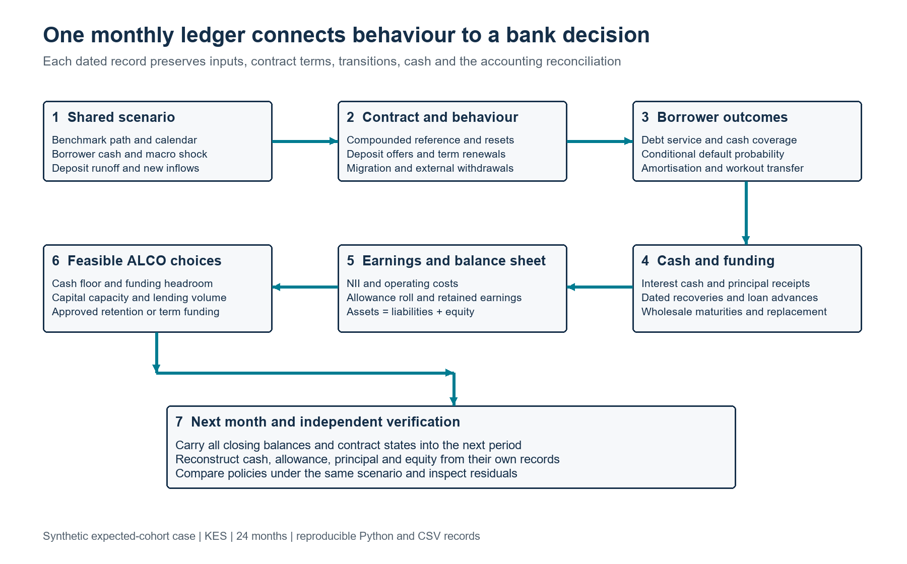

# Deposit Beta Dynamic Loan Deposit and Funding Case

**Nevil Maloba | RegTech KESONIA | 18 October 2026**

## Purpose and economic conclusion

This case gives the Deposit Beta article a complete, reproducible monthly bank scenario. It carries one balance sheet through loan repricing, borrower cash pressure, loan amortisation, default, recovery, deposit pricing, migration, withdrawals and replacement funding. A reader can trace a reported profit to the monthly interest ledger and trace a funding requirement to the cash records. The main result is that a favourable loan repricing margin can be outweighed by deposit replacement and a deteriorating credit outlook. Management responses then become comparisons of profit, liquidity, credit delivery and capital headroom under the same external conditions.

The case uses synthetic assumptions throughout. It is a deterministic expected-cohort model: a default transfer of KES 1 million means the model's expected principal entering workout, rather than a particular borrower observed defaulting. The cash-flow engine provides reproducible economic scenarios. Permissioned histories would support estimation of deposit responses, borrower hazards, dependency and policy effects. This distinction gives the prototype a clear empirical development path.

Four questions organise the case:

1. How do deposit price adjustment, internal migration and external withdrawals jointly affect the cost and quantity of funding?
2. How do contractual repricing and weaker borrower operating cash change expected collections, credit expense and the funding path?
3. Which prespecified ALCO policies preserve an acceptable combination of lending volume, profit, liquidity and capital headroom under the same shock?
4. Can an independent reviewer reconcile each month's cash, principal, allowance, interest receivable, funding and equity from the underlying records?

The framework follows the complementary roles established by CBK: KESONIA is the reference within the revised risk-based credit pricing framework; the borrower premium and institutional funding economics have their own purposes. [1] Deposit-franchise research and empirical evidence on variable betas motivate separating rate sensitivity from retention and testing rising and falling paths. [2], [3] These sources motivate the design; the numerical coefficients and outcomes in this case remain identified synthetic inputs.

## Opening balance sheet and experiment

| Item | Opening value | Economic meaning |
|---|---:|---|
| Performing loans | KES 100.000m | Three amortising pools |
| Cash | KES 6.000m | Opening operating liquidity |
| Management allowance | KES 1.062m | Contra-asset expected principal loss |
| Net assets | KES 104.938m | Cash plus loans less allowance |
| Deposits | KES 80.000m | Operating 40m, savings 25m, term 15m |
| Wholesale borrowing | KES 10.000m | Three-month opening contract |
| Equity | KES 14.938m | Residual after the opening allowance |

The opening gross equity before allowance is KES 16m. The model starts after recognising the opening allowance, so that charge is already reflected in opening equity and is not charged again in the first month's profit. Loans, cash, deposits and funding then evolve over January 2027 to December 2028. Rates are annual decimals, money is Kenyan shillings and monthly interest uses actual calendar days divided by 365. The leap day in February 2028 therefore contributes to interest. No rounding is applied inside the model; displays round results and reconciliation tests use an absolute KES 0.00001 tolerance.

The first loan cohort contains KES 40m amortising over 36 months with monthly coupon resets, initial annual PD of 2% and reference debt-service coverage of 1.30. The second contains KES 35m over 24 months, quarterly resets, 3% PD and 1.20 coverage. The third contains KES 25m over 18 months, six-month resets, 5% PD and 1.10 coverage. All begin with a five-percentage-point margin above the 8% reference assumption. New working-capital lending has a 24-month term and a 3% baseline PD; the standard plan requests KES 5m each month.

Operating deposits initially pay 2%, savings 5% and term deposits 7.6667%, giving a balance-weighted opening rate of 4%. Depositor interest is paid externally rather than capitalised. Operating accounts and savings reprice through separate immediate and lag coefficients. Term cohorts keep their agreed rate until renewal at six months. The withdrawal rates, yield-gap sensitivities and new inflows are all exposed in `assumptions.json`. Migration moves money from savings into a new term cohort at the same bank. It changes product balances and future interest expense, while bank deposit liabilities remain unchanged on the migration itself.

## Monthly timing and information

The bank case reuses `research_lab.benchmark` for dated compounding and `research_lab.operations` for the segmented deposit fit. The synthetic deposit regression is fitted on the frozen history ending December 2024. Its January 2025 onward holdout is retained as separate diagnostic evidence. The fitted intercept is set to zero when applying the response to the new scenario, so a constant synthetic market does not create an unexplained drifting deposit rate. The up/down and lag coefficients are reused unchanged unless the stated sensitivity exercise scales them.

For the reference calculation, the test contract uses five business days of unshifted lookback and a weekends-only calendar. Each dated fixing has an availability timestamp, and the compounding function selects only the observations belonging to the prescribed schedule. This is an explicit computational convention for the synthetic contract. A bank implementation would substitute its approved interpretation of the issued five-day lookback, actual holidays, observations and contract terms. The future scenario contains the whole market path so that the experiment can be replayed; the origination rule uses the current month-end state. It does not read the next month's fixing.

A reset-month coupon combines that month's lookback-adjusted compounded annualised reference with the five-percentage-point margin. The illustrative quarterly and six-month cohorts hold that coupon through the intervening months. The coupon-reset profile is a stated contract assumption. The new facility is advanced at month-end and first earns interest in the following month. Current loan interest is accrued at month-end and paid one month later. The completed monthly observation is therefore available to the origination decision at that boundary.

The order is explicit. Opening deposits earn interest; eligible cohorts withdraw or migrate at month-end; new deposits arrive at month-end. Existing wholesale contracts pay interest and mature. Loan defaults transfer principal into workout, surviving loans pay scheduled principal, and loan interest is accrued. Previously accrued interest is collected. Due workout claims settle. Treasury then executes the prespecified term-funding action, meets the cash floor through available wholesale capacity and considers new lending through the cash and capital gates. Closing reserves, equity and all reconciliation residuals are recorded.



## Deposit equations and retained funding

Let d_g,t be the annual deposit offer for product g at month t and m_t the annual market rate. Write Δm_t = m_t − m_t−1. The applied repricing increment is:

Δd_g,t = b⁺_g max(Δm_t,0) + b⁻_g min(Δm_t,0) + l⁺_g max(Δm_t−1,0) + l⁻_g min(Δm_t−1,0).

The coefficients b describe immediate responses; l describes the one-month lag. The deposit-rate floor is zero. The existing operating-account fit has a cumulative upward response of approximately 0.2523; the rate-sensitive savings fit has approximately 0.7023. Those are distinct segment assumptions. The earlier static example's beta 0.35 remains an independent teaching case and is not substituted for these segment coefficients.

For an eligible cohort, let D be its opening balance, w its external withdrawal fraction and z its savings-to-term migration fraction. Withdrawal W = Dw occurs first; migration M = (D − W)z then moves to a new term cohort. Its original product closes at D − W − M. The receiving term product increases by M. Bank deposits obey:

D_bank,t = D_bank,t−1 + new inflows_t − external withdrawals_t.

Original-cohort deposits obey the same identity without new inflows. Migrated original balances retain their original tag and are exposed to later term withdrawal at maturity. This advances the older component illustration, which retained migrated money indefinitely and did not price its subsequent life. The new model follows the receiving product, renewal date, paid rate and any later external exit.

The withdrawal fraction combines a product-specific base, an assumed response to an increase in the outside-versus-bank yield gap and a scenario runoff increment. Fractions are capped. Savings migration responds to an increase in the term-versus-savings offer gap. Both channels are deliberately visible: increasing a savings offer can reduce departures while adding interest expense. Empirical offer effects would need appropriate identification because banks may change offers in response to anticipated departures. The scenario relationship is a transparent policy-response assumption, not an estimated causal effect.

## Borrower coverage and expected principal movements

The borrower mechanism applies the mature distinction in Underwrite for Collection between observed account activity, operating cash available for service and the contract's actual obligations. [4] Let C_j,t denote estimated cash available for debt service for cohort j; P_j,t is opening principal, n_j,t remaining instalments, r_j,t the annual coupon and δ_t actual days divided by 365. The scheduled service and coverage ratio are:

DS_j,t = P_j,t ÷ n_j,t + P_j,t r_j,t δ_t.

DSCR_j,t = C_j,t ÷ DS_j,t.

The initial cash coefficient is tied to each cohort's reference coverage and original instalment schedule. Expected surviving original principal mass is reduced after defaults, so the cash assumption scales with the surviving cohort rather than creating a windfall for survivors. The joint and credit scenarios reduce estimated operating cash by 25%. Rate shocks separately change the contractual interest component. Annual PD is mapped from coverage by the explicit assumption:

logit(p_j,t) = logit(p₀,j) + 4(DSCR_reference,j − DSCR_j,t) + macro_t.

Here logit(p) = ln[p ÷ (1−p)]. The annual PD is capped at 95%. The macro term adds 0.35 to log odds in the credit and joint stress. The monthly default probability is h_j,t = 1 − (1−p_j,t)^δ_t. Default principal is P_j,t h_j,t; surviving principal is P_j,t(1−h_j,t). Surviving cohorts pay equal principal over their remaining term. The model contains a conditional relationship for expected payment and default, rather than a complete borrower cash-account ledger. Normal operating coverage is a stress predictor; liquidity reserves, owner support and other sources bridging a temporary coverage gap would be additional borrower-level states in a bank-data extension.

Default principal transfers into a workout asset and stops earning interest. After three months, 55% of that principal is recovered in cash and the remaining 45% is written off. Thus a default event, a loss expense, a write-off and a recovery are different dated records. The aggregate example assumes previously accrued interest is collected before current principal enters default. Adding interest arrears, cures, staging and borrower-specific workout processes is a natural extension using Underwrite's multi-state servicing and recovery methods. [4]

## Reserve and accounting derivation

For a performing cohort with current principal P, n remaining equal-principal instalments, annual PD p and LGD λ, define h = 1 − (1−p)^(1/12). The management allowance is:

A_performing = λ Σ(k = 0,…,min(12,n)−1) P(1−k/n)(1−h)^k h.

The term P(1−k/n) is scheduled exposure, (1−h)^k is survival to month k and h is conditional default probability in that month. This is an undiscounted, constant-hazard twelve-month expected-principal-loss approximation. Each unsettled workout claim carries allowance λ times gross workout principal. The total A_t is the sum. IFRS 9 adds its specified horizon, staging, forward-looking information and discounting requirements; those would govern an institution's accounting implementation. [5]

At workout settlement, both the gross claim and its associated allowance are removed. The debit to cash is the recovered 55%, and the remaining 45% uses the allowance. The period's impairment expense is therefore:

E_t = A_t − A_t−1 + W_t.

W_t denotes principal written off in that period. The model charges E_t in the income statement and records cash recovery separately. It does not subtract the same write-off again from profit. Equity follows:

Equity_t = Equity_t−1 + NII_t − operating cost_t − E_t.

Taxes, distributions, fee income, investment trading, collateral calls and derivatives are outside this bounded fixture. Cash earns 3% on its opening positive balance. NII includes accrued loan interest and cash income, less paid deposit and wholesale interest. Cash NII uses loan interest received instead. The difference over the full horizon equals the ending interest receivable, because the opening receivable is zero. Reported annualised NIM divides cumulative NII by the sum of period-opening performing loans plus positive cash, each multiplied by its actual year fraction.

The complete monthly balance check is:

Cash + performing principal + gross workout claims + interest receivable − allowance = deposits + wholesale borrowing + equity.

Independent tests also reconstruct cash directly from receipts and payments. This matters because a balanced balance sheet alone could conceal mutually offsetting mistakes in two entries.

## Funding and lending decisions

The teaching cash floor is KES 6m. Aggregate wholesale funding is capped at KES 45m. Replacement contracts mature after three months and pay the prevailing market rate plus two percentage points. The prefunding policy raises KES 10m in month two for twelve months, at the then-current market rate plus 2.5 percentage points. It is a prespecified policy tested against the same paths, rather than a policy trained on those paths. Its initial excess cash has a carrying cost and its future maturity re-enters the funding schedule.

The capital proxy is book equity divided by performing principal plus gross workout claims, with unit risk weights and a 12% internal teaching floor. It is a transparent constraint for the experiment, not a regulatory capital calculation. If E is equity after the current period's pre-origination earnings, R the current proxy exposure, k the floor and a the expected allowance per unit of a proposed new loan, then:

(E − ax) ÷ (R + x) ≥ k.

Solving gives x ≤ (E − kR) ÷ (k + a). The model admits the minimum of requested lending, nonnegative capital capacity and cash capacity including unused wholesale funding. A tighter-capital test confirms that this gate can stop new lending; a tighter-funding test confirms that the facility limit curtails lending. If required existing cash payments exceed available funding, the retained negative cash/floor gap is reported as an unfunded shortfall and the scenario is flagged infeasible. The code does not conceal it with an unlimited funding plug.

Articles 4 and 5 of the causal-credit research sequence supply the broader rationale for constrained policy comparison and governed execution. [6], [7] The present choices are transparent benchmark policies for that programme. Bank-controlled agents could assemble the inputs, reconcile the scenario packet and route a recommendation. Treasury, Credit and ALCO would own the approved business decision and execution records.

## Economic results and interpretation

All amounts below are KES millions over 24 months unless otherwise stated. The scenario inputs apply from month three onward. Each main path maintains the teaching cash and capital floors; separate boundary tests exercise binding constraints.

| Scenario and policy | NII | Credit expense | Profit | New lending | Peak wholesale |
|---|---:|---:|---:|---:|---:|
| Baseline | 17.640 | 1.309 | 12.731 | 120 | 11.952 |
| Rates up 200 bp | 19.076 | 1.578 | 13.898 | 120 | 12.383 |
| Rates down 200 bp | 15.704 | 1.062 | 11.042 | 120 | 11.928 |
| Additional deposit runoff | 16.351 | 1.309 | 11.442 | 120 | 19.814 |
| Borrower credit stress | 16.472 | 9.002 | 3.870 | 120 | 11.993 |
| Joint stress | 16.013 | 9.829 | 2.584 | 120 | 20.861 |
| Joint plus savings premium | 15.962 | 9.829 | 2.532 | 120 | 20.431 |
| Joint plus term prefunding | 16.108 | 9.829 | 2.679 | 120 | 21.555 |
| Joint plus controlled growth | 15.464 | 8.253 | 3.611 | 90 | 20.305 |

The pure rate increase helps earnings because asset coupons increase faster than the aggregate deposit cost, even after the additional expected loss caused by debt-service pressure. The falling-rate scenario lowers NII because some liability costs adjust more slowly. The runoff scenario has the same borrower conditions as baseline, so credit expense is unchanged; the profitability difference arises in funding. The credit scenario keeps deposit conditions unchanged and shows the effect of weaker borrower service capacity on losses and expected cash. The joint scenario combines both channels, allowing their interaction to appear in the funding path.

The month-three joint shock is particularly instructive. NII is positive KES 0.783m, but the allowance increase produces credit expense of KES 3.962m; after KES 0.150m operating costs, the month records a KES 3.329m loss. No recoveries have yet arrived. The minimum capital proxy falls to approximately 12.345%, close to its 12% teaching floor. This explains why a bank can have a positive interest margin, a funding requirement and an immediate need to reconsider risk capacity at the same time.

A higher savings offer retains about KES 0.346m more deposits at the end of the joint path. Its additional interest cost outweighs the saving on replacement funding under the stated response assumption: profit falls by about KES 0.052m. Prefunding improves joint profit by about KES 0.095m, while peak gross wholesale funding is higher because the policy raises term funding before it is needed. The controlled-growth combination earns KES 1.027m more than the standard joint case while advancing KES 30m less new credit. That is a joint profitability-and-volume decision; a lending-capacity objective would weigh that output explicitly.

The nine sensitivity cases scale all immediate and lag beta coefficients by 0.75, 1.00 or 1.25 and set additional eligible monthly runoff to 1.0%, 2.5% or 4.0%. Joint-stress profit ranges from KES 1.572m to KES 3.721m. Those bounds describe the selected parameter scenarios. Bayesian credible intervals would require a fitted probability distribution for those parameters and dependencies; a confidence statement cannot be inferred from this grid alone.

## Reproduction and reviewer route

Run from the repository root:

```text
python -B -m research_lab.deposit_beta_dynamic_case.run_case
python -B -m research_lab.deposit_beta_dynamic_case.build_publication
```

The model, assumptions and runners live in `research_lab/deposit_beta_dynamic_case`. The independent checks live in `tests/test_deposit_beta_dynamic_case.py`. `output/deposit_beta_dynamic_case_2026-10-18` contains every scenario's monthly bank rows, loan-cohort records, deposit-cohort records, explicit policy events, summaries, the sensitivity grid, the reused component fit and future-holdout diagnostic, the static bridge, test log and hash manifest. All 21 tests pass. The maximum monthly reconciliation residual is approximately KES 0.000000052 across the nine main cases.

The original static article bridge remains a useful hand check: KES 8.8m initial annual NII; KES 1.24m gain from repricing; KES 0.584m replacement-funding cost; KES 0.900m additional one-year expected loss; net change negative KES 0.244m. It uses constant balances, immediate resets and beta 0.35. The dynamic case changes those assumptions explicitly, so its two-year outputs should not be compared as if they were the same experiment.

For a presentation, begin with that five-line bridge. Then show the monthly rate chart, the deposit/loan/funding chart, the NII-versus-credit-expense chart and the ALCO comparison. Finish by opening one month in `monthly.csv` and reconstructing its cash and equity. This gives the audience a concrete path from intuition to an inspectable implementation.

The article and Word edition preserve the two original conceptual diagrams and add four numerical charts. Two further standalone assets show cash/equity and the complete monthly flow. All six new charts are regenerated by Python from saved calculation outputs. `publication_manifest.json` records the article, Word and asset build metadata.

## References

[1] Central Bank of Kenya, "Revised Risk-Based Credit Pricing Model," Aug. 2025. [Online]. Available: https://www.centralbank.go.ke/wp-content/uploads/2025/08/Revised-Risk-based-Credit-Pricing-Model.pdf

[2] I. Drechsler, A. Savov, and P. Schnabl, "Banking on Deposits: Maturity Transformation without Interest Rate Risk," *The Journal of Finance*, vol. 76, no. 3, pp. 1091–1143, 2021, doi: 10.1111/jofi.13013. Author manuscript: https://pages.stern.nyu.edu/~asavov/alexisavov/Alexi_Savov_files/BankingOnDeposits.pdf

[3] M. Emin, C. James, and T. Li, "Variable deposit betas and bank exposure to interest rate risk," *Journal of Financial Intermediation*, vol. 62, art. no. 101147, 2025, doi: 10.1016/j.jfi.2025.101147. Available: https://www.sciencedirect.com/science/article/pii/S1042957325000154

[4] N. Maloba, *Underwrite for Collection*, integrated research edition, 2026, particularly cash evidence, servicing and Part 5 funding. doi: 10.5281/zenodo.23343888. Available: https://doi.org/10.5281/zenodo.23343888

[5] IFRS Foundation, "IFRS 9 Financial Instruments," standard resources. Available: https://www.ifrs.org/issued-standards/list-of-standards/ifrs-9-financial-instruments/

[6] N. Maloba, "Can Reinforcement Learning Help Run a Bank's Balance Sheet?", Article 4 in *Causal Credit and Treasury Decision-Making*, 2026. Available: https://github.com/TheAlchemistNerd/underwrite-for-collection/blob/main/series/publications/linkedin/2026-10-08_causal_credit_series/ARTICLE_4_TREASURY_ALM_STOCHASTIC_CONTROL.md

[7] N. Maloba, "Bringing the Methods into the Bank", Article 5 in *Causal Credit and Treasury Decision-Making*, 2026. Available: https://github.com/TheAlchemistNerd/underwrite-for-collection/blob/main/series/publications/linkedin/2026-10-08_causal_credit_series/ARTICLE_5_BANK_CONTROLLED_AGENTIC_AI_CREDIT_AND_TREASURY.md

External source locations checked 18 October 2026. The existing research whitepaper DOI is retained as the stable citation; the research-series files provide method-level context.
