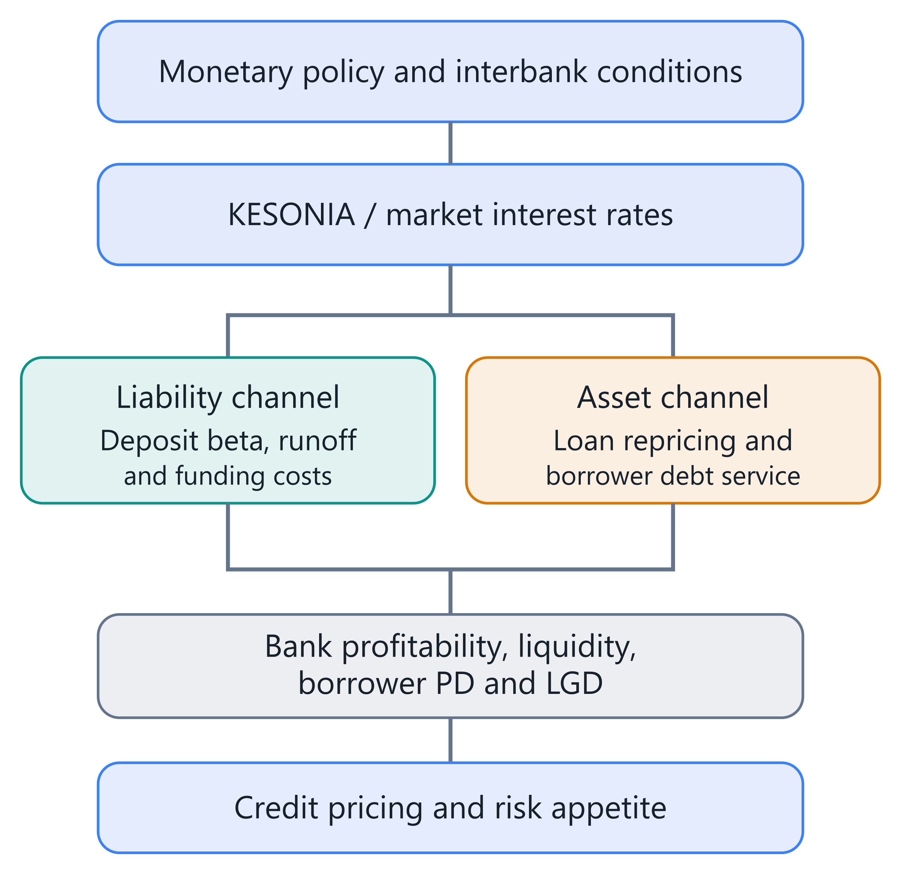
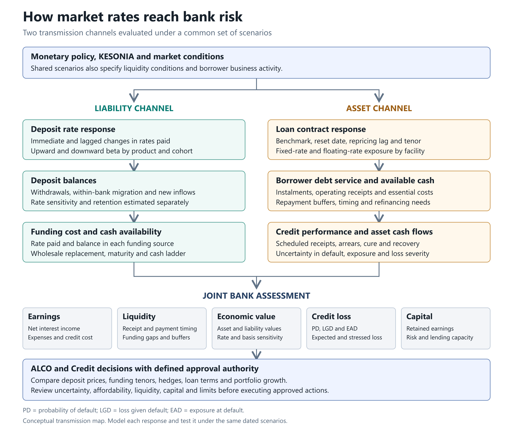

**Editorial metadata:** Article body: 3,500 words, including title, headings, research questions and equations; captions, diagram labels and reference list excluded. Count method is documented in the accompanying source/coverage note. Prepared 16 October 2026.

<!-- ARTICLE BODY START -->

# Deposit Beta, KESONIA and the Economics of a Resilient Bank

## Abstract

A bank can earn more interest after a rate increase and still become less resilient. Its deposits may reprice slowly at first, then migrate into expensive products or leave. Borrowers may face larger instalments before their revenues recover. Treasury must manage these developments together.

Deposit beta measures the response of deposit rates to a market benchmark. Its real value emerges when we connect that response to deposit retention, loan cash flows, internal funding prices and capital capacity. Kenya's transition to KESONIA makes this connection particularly useful: the Central Bank of Kenya reports that the revised Risk-Based Credit Pricing Model was fully implemented in March 2026. [1]

This article develops a practical research framework for that connection. It moves from a simple ratio to a joint assessment of earnings, economic value, liquidity and borrower risk, then translates the results into decisions for the asset and liability committee, or ALCO.

## Four research questions

1. How do deposit repricing speed, cumulative beta and balance retention differ across Kenyan customer segments, products and interest-rate regimes?
2. Does jointly modelling deposit prices, product migration and withdrawals improve forecasts of funding costs and liquidity needs?
3. How do KESONIA-linked debt service and changing borrower cash flows interact with deposit behaviour to affect risk-adjusted bank profitability?
4. Which funding, pricing and hedging policies remain effective when behavioural estimates are uncertain and market conditions change?

## 1. Start with two transmission channels

KESONIA is the volume-weighted rate on unsecured overnight interbank transactions in Kenya. It is administered by CBK and continues the existing overnight interbank methodology under a clearer benchmark identity. [2]

The revised framework adopts KESONIA compounded in arrears for in-scope variable-rate loans, excluding fixed-rate and foreign-currency loans. The customer rate combines the reference with a premium, K, covering lending costs, shareholder return and borrower risk. Fees and charges are separately disclosed. [3]

In compact form:

r_loan = compounded KESONIA + K.

That customer-facing formula sits alongside an internal economic question: what does funding this loan actually cost the bank over its expected life?

The liability channel runs from market rates through deposit pricing, withdrawals, product migration and wholesale funding. The asset channel runs through contractual loan repricing, debt service and borrower cash flows. Their interaction changes income, liquidity, expected losses and the capacity to lend.

Deposit beta belongs primarily to the liability channel. Borrower credit risk also changes through the asset channel, even when deposit rates barely move. A floating-rate borrower can experience immediate payment pressure while the bank temporarily enjoys cheaper funding.

This distinction improves decision-making. Treasury can assess funding resilience while Credit assesses repayment capacity, using the same economic scenarios. Their outputs meet in the bank's earnings and capital assessment.

Figure 1. Market-rate transmission through funding and borrower repayment. PD means probability of default; LGD means loss given default.

## 2. Define the beta before comparing it

The familiar calculation is:

β_D = Δr_D ÷ Δr_M.

Here r_D is a specified deposit rate and r_M is a specified market rate, measured over the same interval. A 35-basis-point deposit increase following a 100-basis-point benchmark increase gives β_D = 0.35. One basis point equals 0.01 percentage point.

The choice of deposit rate matters. A posted savings rate, a rate offered to new customers and an average rate implied by interest expense answer different questions. Including non-interest-bearing balances also changes the denominator. The New York Fed's deposit research explicitly distinguishes interest-bearing and total-deposit measures. [4]

Three labels make estimates usable: immediate beta, cumulative beta over a defined horizon, and longer-run pass-through from an estimated model.

Suppose a 100-basis-point benchmark increase produces a 20-basis-point deposit increase this month and another 15 next month. Immediate beta is 0.20; the two-month cumulative response is 0.35. A model using only the first month understates subsequent funding expense.

A ratio also becomes unstable when the benchmark barely changes. Deposit rates can continue adjusting after a policy pause, producing a large ratio or an undefined denominator. A coefficient estimated from a suitable time-series model is more informative in that setting.

Finally, a zero posted-rate beta does not mean free funding. Account servicing, payment infrastructure, liquidity buffers and customer acquisition still consume resources. Nor does it establish that balances will remain. Rate sensitivity and balance persistence need separate evidence.

Figure 2. The liability and asset channels meet in a common assessment of earnings, liquidity, economic value, credit loss and capital, supporting ALCO and Credit decisions.

## 3. Evidence favours changing betas

International findings provide hypotheses for Kenyan research.

Emin, James and Li examine US bank data from 1997–2023. Their two pass-through measures average approximately 0.30 and 0.46. One measure averages 0.26 when the federal funds rate is below 2%, compared with 0.49 above 2%. These are distinct estimators and regime summaries, not a universal calibration range. Their central finding is that deposit pass-through changes with the rate environment, altering the effectiveness of deposits as an interest-rate hedge. [5]

The speed also changes. New York Fed researchers report cumulative interest-bearing beta near 0.4 by the fourth quarter of 2022, reached in roughly one year versus about three years during the previous tightening cycle. [6]

Dias and Scott's 2025 Federal Reserve working paper links funding pass-through to the duration, magnitude and direction of monetary cycles; nondeposit funding adjusts more strongly than deposits. [7]

Together, these findings motivate testing rate levels, cycle duration, competition and funding composition. They do not establish a Kenyan household savings beta or a fixed ranking across every bank.

A bank should therefore compare models across rising, falling and stable-rate periods. An apparently excellent fit during abundant liquidity can conceal weak performance when customers begin comparing yields or corporate treasurers concentrate cash elsewhere.

The falling-rate case deserves equal attention. Suppose loan yields reset down immediately, while negotiated deposits remain at previously agreed rates until renewal. Funding relief arrives later than asset repricing. A deposit-rate floor can further limit reductions, even where upward pass-through was modest. Once a floor binds, extrapolating a symmetric linear coefficient would forecast an impossible rate.

A useful challenger therefore combines separate upward and downward responses with explicit contractual or operational floors. Test forecasts through turning points and policy pauses. Include the time since the last material move: delayed repricing can continue when the current market-rate change is zero.

The practical question becomes: how much repricing remains after today's decision, and what would accelerate it?

For Kenyan estimation, the renamed benchmark's publication start should not be mistaken for the beginning of interbank-rate history. Earlier observations can extend the sample if definitions, calendars and data quality are reconciled. The pricing reform still creates a potential structural break: contractual loan transmission can change even if the overnight benchmark methodology does not.

Separate household transaction balances, discretionary savings, institutional balances and negotiated corporate accounts where data support the distinction. Concentration deserves its own measure. Ten customers holding most of a segment create a different liquidity exposure from thousands of small accounts with the same average beta. The relevant unit of analysis is the relationship controlling the money, including linked accounts and related entities.

## 4. Estimate timing, asymmetry and uncertainty

A useful baseline separates increases from decreases and allows delayed responses:

Δd_g,t = a_g + Σⱼ b⁺_g,j max(Δm_t−j, 0) + Σⱼ b⁻_g,j min(Δm_t−j, 0) + γ′X_g,t + ε_g,t.

The index g identifies a deposit segment; j identifies the lag. The coefficients b⁺ and b⁻ describe upward and downward responses. X contains justified explanatory variables, such as competing offers or customer composition. Their availability at the forecast date must be recorded.

Cumulative upward pass-through over the chosen lag window is Σⱼ b⁺_g,j. Lag length should reflect evidence and decision horizons.

For sparse segments, hierarchical estimation can share information while preserving differences:

b⁺_g,j ~ Normal(μ⁺_j, τ²_j).

The population mean μ and between-segment variance τ² are estimated jointly with segment coefficients. This pooling can stabilise small samples without declaring that payroll accounts and negotiated corporate deposits behave identically.

Nonlinearity can enter through rate-level splines or interactions with a clearly defined regime. Model comparison should determine whether that flexibility improves forecasts enough to justify its complexity.

A synthetic reference laboratory provides a useful starting point: synthetic segment panels, separate upward and downward coefficients, one-month lags, and a frozen future holdout. Its training error rises materially when the invented future repricing regime changes. That demonstrates a validation workflow and a failure mode.

The next advance is permissioned bank data, robust uncertainty estimates and testing across genuine regime changes. Report forecast intervals and economically meaningful errors, including the funding-cost impact of a missed beta. A statistically small error on a large deposit base can still change a lending decision.

A beta estimate should also carry its denominator and weighting convention into the committee pack. A balance-weighted average describes the funding bill; an equal-weighted customer average describes a typical relationship. Both can be useful, but they answer different questions. Changes in customer composition can move the first while individual pricing policies remain unchanged. Report the reconciliation alongside segmentation results. For uncertainty, distinguish parameter uncertainty from uncertainty about future market paths and customer responses. Varying only the benchmark shock while holding every behavioural estimate fixed understates the range of outcomes that management needs to consider before approving a strategy.

## 5. Model the money as well as the rate

Non-maturing deposits have no contractual maturity, yet aggregate balances can persist through repeated customer activity. Persistence should be measured at several levels: account, customer relationship, original cohort, product and whole bank.

Consider a savings product that opens with KES 100 million. During a month, KES 8 million leaves the bank, KES 12 million moves to the bank's term deposits, and KES 15 million arrives from new customers. The product closes at KES 95 million.

Its original cohort retains KES 80 million in that product. The bank retains KES 92 million of the original cohort, including the migrated balances. New inflows explain why the product total looks more stable than the original funding.

These quantities answer different questions. Product retention informs repricing and replication; bank retention informs external funding needs; new inflows describe acquisition and replenishment.

A migration matrix can track transfers among current, savings and term deposits, with exit as a separate state. Rates paid in the destination products must follow the money. Otherwise, the model recognises retention while missing its cost.

A withdrawal model can then condition on yield gaps, concentration, transaction activity and customer characteristics. Rate decisions and withdrawals are jointly determined: banks may increase rates precisely because balances are leaving. Predictive association alone cannot identify how an alternative offer would change retention.

Kenyan research also benefits from recognising market feedback. Osoro and Talam's study of 2013–2024 data finds dynamic interactions among policy and financial-market prices, highlighting interbank segmentation. That supports examining transmission as an empirical relationship with feedback. [8]

## 6. Translate behaviour into a replicating portfolio

A replicating portfolio represents deposit behaviour using market instruments with different maturities and repricing dates. It helps Treasury assign internal value to stable funding and assess interest-rate exposure.

Drechsler, Savov and Schnabl develop the economic argument that a deposit franchise with relatively insensitive funding costs can support longer-term fixed-rate assets. Their evidence makes matching income and expense sensitivity central to the interpretation of maturity transformation. [9]

For implementation, choose replication weights subject to observed retention, liquidity needs, concentration and approved maturity limits. A candidate objective can minimise scenario-weighted earnings mismatch plus transaction costs, while constraining economic-value sensitivity.

For example, a proposed KES 100 million ladder might hold KES 20 million overnight, KES 30 million in two-year instruments and KES 50 million in five-year instruments. Its weighted average contractual maturity is 3.1 years. That arithmetic does not establish its suitability. Treasury needs evidence that balances support the ladder and that the instruments' cash flows, saleability and risk are acceptable.

Basel's standardised IRRBB framework differentiates NMD categories. It caps core proportions and average core maturities at 90% and five years for retail transactional deposits, 70% and 4.5 years for retail nontransactional deposits, and 50% and four years for wholesale deposits. These are framework-specific constraints requiring an applicable supervisory mapping. [10]

A local prototype already enumerates short cash ladders under synthetic retention bounds. Developing it into a rolling replication strategy requires reinvestment, changing balances, instrument pricing, costs and stress testing.

The governing principle is simple: beta informs repricing; retention informs the amount available through time. Neither alone determines deposit duration.

## 7. Read NII and EVE together

Net interest income, NII, measures interest income less interest expense over a stated horizon. Net interest margin, NIM, scales NII by average interest-earning assets.

Economic value of equity, EVE, assesses the present value of asset cash flows less liability cash flows, including relevant off-balance-sheet positions. Basel's IRRBB approach requires attention to both earnings and economic-value perspectives. [10]

The distinction changes the interpretation of a rate shock. Floating loan income may rise within a year while the value of long fixed-rate securities falls. Deposit repricing may remain low initially, yet a higher future beta can reduce the economic benefit of the deposit franchise.

A good report therefore displays the same scenario through several windows: monthly cash needs, annual NII, longer-horizon earnings and EVE sensitivity. It should identify which balances run off, which are replaced and which new business is assumed.

For replication, ask whether the proposed ladder stabilises earnings only under a constant balance sheet. Then allow migration, withdrawals and changing customer rates. A strategy can look attractive until its funding quantity becomes endogenous.

Hedge evaluation adds another cash-flow layer. A derivative may reduce rate sensitivity while requiring collateral during stress. Include those calls in liquidity projections, with settlement dates and available assets. The resulting decision concerns income, value and survival through the path.

## 8. Make FTP carry the economics

Funds transfer pricing, FTP, allocates funding and liquidity economics internally. It connects the deposit business, lending business and Treasury.

US interagency guidance describes FTP as a way to allocate funding and contingent-liquidity risks and align business incentives with the institution's risk appetite. Its supervisory perimeter is American; its economic design principles offer a useful comparison. [11]

For a Kenyan bank, an illustrative loan hurdle is:

Required loan yield = FTP charge + expected-loss spread + operating-cost spread + capital-return charge + target residual margin.

This is an internal analytical decomposition. Its components must reconcile with the approved customer premium and contract.

The deposit business receives an internal funding credit and pays customer interest and servicing costs. The lending business earns customer income and pays its internal funding charge. Treasury manages the transferred mismatch. Internal charges and credits eliminate when the bank consolidates them.

This prevents a misleading result: changing FTP can move reported profit between departments without creating bank-wide income.

Behavioural assumptions influence the deposit credit. Overstating stability can reward aggressive gathering of fragile balances and encourage long-duration lending. Understating stability can undervalue a useful transaction franchise.

The solution is transparent attribution: show the curve, behavioural maturity, liquidity adjustment, option cost, uncertainty and residual held by Treasury. Review the incentives alongside the numerical result.

## 9. Follow a 200-basis-point shock through the bank

Begin with a simple illustration: loan yield is 13%, deposit rate is 4%, and both quantities remain unchanged. After a 200-basis-point benchmark increase, fully repricing loans yield 15%.

At beta 0.30, deposits cost 4.60%; the loan-minus-deposit spread increases from 9.00 to 10.40 percentage points. At beta 0.35, deposits cost 4.70%; the spread reaches 10.30 percentage points. The gains are respectively 140 and 130 basis points.

Those are two different assumptions. The spread also differs from bank NIM because loans and deposits need not have equal balances.

Now use an invented balance sheet: KES 100 million of interest-earning loans, funded by KES 80 million of deposits, KES 10 million of wholesale borrowing and KES 10 million of equity. Initial annual rates are 13%, 4% and 10%, respectively.

Baseline annual NII is:

100m × 13% − 80m × 4% − 10m × 10% = KES 8.8m.

Assume all loans and wholesale borrowing reprice immediately by 200 basis points, deposit beta is 0.35, and balances stay constant for a full year. NII rises by:

KES 2.0m − KES 0.56m − KES 0.20m = KES 1.24m.

With unchanged earning assets, NIM rises from 8.80% to 10.04%.

Next, KES 8 million of deposits leaves at the start of the year and is replaced with wholesale funding at 12%. Relative to retaining those deposits at 4.70%, replacement costs:

KES 8m × (12% − 4.70%) = KES 584,000.

There is also a portfolio identity behind changing funding shares:

Funding cost = Σₖ wₖrₖ.

Its change includes repricing existing funding and changing the weights. In an exact discrete decomposition, Δcost = Σₖ wₖ,old Δrₖ + Σₖ rₖ,old Δwₖ + Σₖ ΔwₖΔrₖ. The final term captures their interaction. Replacing cheap deposits with expensive wholesale money changes both the composition and the rates paid.

This decomposition lets Finance explain why realised expense exceeded a beta-only forecast. It also distinguishes a deposit-pricing error from a successful retention decision whose cost was budgeted incorrectly.

The NII improvement falls to KES 656,000. Finally, assume one-year PD rises from 2% to 4%, LGD stays at 45%, and EAD remains KES 100 million. Simplified expected loss rises by KES 900,000.

The change in NII less this expected-loss charge is now negative KES 244,000. All numbers are scenario assumptions. The calculation isolates why attractive repricing can coexist with weaker risk-adjusted contribution.

## 10. Connect credit risk through cash flows

The starting credit approximation is:

EL = PD × LGD × EAD.

All inputs require the same horizon and consistent definitions. A one-period expected principal loss is useful for scenario analysis; IFRS 9 measurement additionally requires the relevant expected-credit-loss framework and forward-looking assessment. [12]

Model borrower stress through contractual payments and cash available for debt service. For a business, the debt-service coverage ratio compares that cash with scheduled interest and principal. Recalculate both when sales, costs, rates or working capital change.

A hierarchical credit model can share information across sectors while allowing different sensitivities. Its group-level effects and uncertainty must remain explicit. A survival model can instead estimate default hazards over successive periods; cumulative default probability then follows from the sequence of conditional survival probabilities.

These are alternative modelling structures with different outputs. Choosing one depends on the loan history, censoring, observation frequency and decision horizon.

For causality, distinguish a rate increase from the economic conditions accompanying it. Inflation, demand and exchange rates may affect repayment simultaneously. Credit interventions also change outcomes, so realised collections should be linked to the actual treatment and timing.

Deposit beta does not mechanically instruct a bank to expand risky lending or retreat into lower-premium customers. A funding advantage can support competitive pricing, stronger buffers or additional credit. A squeeze can justify repricing, funding changes, lower volumes or more selective origination. The choice depends on marginal risk-adjusted returns and constraints.

## 11. Build evidence that changes decisions

A practical research programme starts with a reconciled monthly panel and a clear decision date. Preserve product rates, paid interest, average balances, original cohorts, migration, external withdrawals, new inflows and contractual features. Link benchmark observations to their publication dates.

Fit a transparent baseline before adding complexity. Compare asymmetric lag models with regime-sensitive alternatives using rolling future periods. Evaluate rate error, balance error, funding-cost error and the resulting ALCO decision. Uncertainty should travel through the scenario engine.

The strongest validation asks whether the chosen funding or hedge policy remains acceptable under plausible alternative estimates. Reverse stress testing can identify the combination of beta, runoff and borrower deterioration that exhausts a specified earnings or liquidity buffer.

Separate the purposes of each quantity. Internal retention forecasts inform management actions; regulatory liquidity classifications follow their applicable rules; accounting provisions follow their measurement basis. A common data foundation can support all three without collapsing their meanings.

For policy evaluation, run paired scenarios with identical market and borrower shocks. In one, retain existing deposit offers; in another, increase selected offers; in a third, substitute term funding. Estimate the resulting retention, interest expense, liquidity and credit capacity under each policy. Charge implementation and acquisition costs explicitly.

This design isolates the management choice inside the simulator. To establish an effect in practice, use credible variation in offers or a governed experiment where appropriate. Account for customer selection, spillovers and concurrent campaigns. A simulated improvement is a candidate for testing, while an observed forecast improvement is evidence about prediction. Neither automatically establishes that changing the offer caused the improvement.

ALCO should receive a concise decision pack: scenario and horizon, expected NII and EVE changes, liquidity gaps, credit-loss sensitivity, binding limits, feasible actions and named owners. Show the cost of waiting and the consequence of being wrong.

For example, a deposit-retention trigger could require Treasury to compare the cost of a targeted rate increase with replacement funding before withdrawals breach a defined buffer. A borrower trigger could route deteriorating coverage to a credit review before arrears emerge. The committee should approve thresholds against historical false alarms, available execution capacity and the consequences of delayed action.

Record each decision and revisit it against realised results. Attribute the difference to benchmark movements, deposit rates, migration, external runoff, loan repricing, credit losses and management actions. This makes behavioural modelling part of a learning process: forecasts inform decisions, decisions generate evidence, and the next review can improve both.

The opportunity is to turn deposit beta into a bridge between customer behaviour and bank strategy. KESONIA supplies a transparent reference. Deposit and borrower models explain how customers respond. Treasury integrates the resulting cash flows. ALCO decides how much risk the bank can carry while continuing to lend sustainably.

<!-- ARTICLE BODY END -->

## References

[1] Central Bank of Kenya, “36th Monetary Policy Committee Report,” Apr. 2026, pp. 13, 20. [Online]. Available: [Source](https://www.centralbank.go.ke/uploads/monetary_policy_reports/131378250_36th%20Monetary%20Policy%20Committee%20Report,%20April%202026.pdf)

[2] Central Bank of Kenya, “KESONIA Interest Rate Benchmark,” overview and FAQs. [Online]. Available: [Source](https://www.centralbank.go.ke/kesonia/)

[3] Central Bank of Kenya, “Revised Risk-Based Credit Pricing Model,” Aug. 2025, sec. 4 and app. I. [Online]. Available: [Source](https://www.centralbank.go.ke/wp-content/uploads/2025/08/Revised-Risk-based-Credit-Pricing-Model.pdf)

[4] A. Kang-Landsberg and M. Plosser, “How Do Deposit Rates Respond to Monetary Policy?,” Federal Reserve Bank of New York, Liberty Street Economics, Nov. 21, 2022. [Online]. Available: [Source](https://libertystreeteconomics.newyorkfed.org/2022/11/how-do-deposit-rates-respond-to-monetary-policy/)

[5] M. Emin, C. James, and T. Li, “Variable deposit betas and bank exposure to interest rate risk,” Journal of Financial Intermediation, vol. 62, art. no. 101147, 2025, doi: 10.1016/j.jfi.2025.101147. [Online]. Available: [Source](https://www.sciencedirect.com/science/article/pii/S1042957325000154)

[6] A. Kang-Landsberg, S. Luck, and M. Plosser, “Deposit Betas: Up, Up, and Away?,” Federal Reserve Bank of New York, Liberty Street Economics, Apr. 11, 2023. [Online]. Available: [Source](https://libertystreeteconomics.newyorkfed.org/2023/04/deposit-betas-up-up-and-away/)

[7] D. A. Dias and S. C. Scott, “Monetary Policy and Bank Funding Costs: Patterns and Predictability in the Transmission of the Policy Rate to U.S. Banks’ Funding Costs,” Finance and Economics Discussion Series 2025-083, Board of Governors of the Federal Reserve System, 2025. [Online]. Available: [Source](https://www.federalreserve.gov/econres/feds/files/2025083pap.pdf)

[8] J. Osoro and C. C. Talam, “Monetary Policy at the turn of Financial Markets: A Forerunner or Follower?,” Kenya Bankers Association, Working Paper 89, WPS/04/25, Mar. 2025. [Online]. Available: [Source](https://www.kba.co.ke/wp-content/uploads/2025/04/WPS-89-Osoro-Talam.pdf)

[9] I. Drechsler, A. Savov, and P. Schnabl, “Banking on Deposits: Maturity Transformation without Interest Rate Risk,” The Journal of Finance, vol. 76, no. 3, pp. 1091–1143, 2021, doi: 10.1111/jofi.13013. [Online]. Available: [Source](https://doi.org/10.1111/jofi.13013)

[10] Basel Committee on Banking Supervision, “SRP31: Interest rate risk in the banking book,” Basel Framework, especially paras. 31.4, 31.108–31.112 and table 4, version published Dec. 15, 2019. [Online]. Available: [Source](https://www.bis.org/committees/bcbs/basel-framework/standard/srp/31/inforce/2019-12-15/published/2019-12-15)

[11] Board of Governors of the Federal Reserve System, “SR 16-3: Interagency Guidance on Funds Transfer Pricing Related to Funding and Contingent Liquidity Risks,” Mar. 1, 2016. [Online]. Available: [Source](https://www.federalreserve.gov/supervisionreg/srletters/sr1603.htm)

[12] IFRS Foundation, “IFRS 9 Financial Instruments,” issued-standard and implementation resources. [Online]. Available: [Source](https://www.ifrs.org/issued-standards/list-of-standards/ifrs-9-financial-instruments/)

All online sources accessed October 16, 2026.
