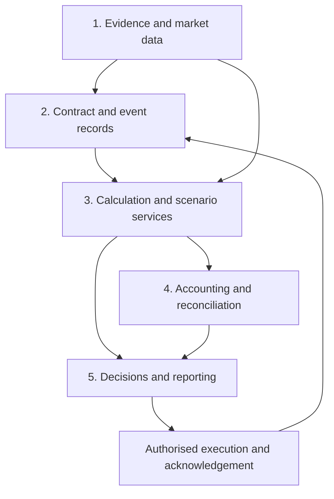

# Part 1: KESONIA, Cash Flows and the Architecture of Credit Decisions

**Series:** Operationalising KESONIA: benchmark calculations, credit economics, treasury and governed operations
**Author:** Nevil Maloba
**Revision:** 1 October 2026

> LinkedIn reading edition, synchronised with the 1 October technical revision. Formulas are retained for the downloadable HTML; launch-post copy is separate.

## Abstract

Kenya's adoption of KESONIA within the revised Risk-Based Credit Pricing Model (RBCPM) links a common interest-rate benchmark to institution-specific credit pricing. KESONIA and RBCPM are complementary: the benchmark provides the reference, while the approved pricing model determines the customer premium. The series examines the architecture needed to connect benchmark data, contracts, pricing, funding, accounting and controls. The institution must connect a dated contract, the benchmark observations available at the calculation time, an approved price, the accounting event and the eventual cash receipt. This article develops a responsibility-based architecture for doing so. It distinguishes observed rates from future curves, customer prices from internal funding charges, and borrower cash from investor distributions. The companion laboratory supplies reproducible teaching calculations; production interfaces, empirical models and institution-specific applicability require their own evidence.

## 1. Start with the payment, then follow the information

A distributor buys stock today, sells it over several weeks and expects its largest customer to pay after the next loan instalment. Its credit score may be unchanged, yet the facility can still create a cash shortfall. If the loan rate rises, the lender also needs to understand whether the additional contractual interest will be collected, whether its own funding has repriced and whether the business can continue operating after payment.

Three records answer different parts of this problem:

1. The **contract schedule** states what the borrower owes and when.
2. The **behavioural cash forecast** estimates what will actually be received, including delay, prepayment, default and recovery.
3. The **funding schedule** states when the lender must pay depositors, funders and counterparties.

A correct benchmark calculation strengthens the first record. It does not make the other two correct automatically. The series therefore follows a common contract through observation, accrual, pricing, funding, accounting and execution. The practical question is: **can a reviewer reproduce both the amount and the decision from the evidence available at that time?**

The distinction also matters upstream. A new borrowing increases a business's cash balance but is not sales income; an internal transfer may relocate cash without increasing consolidated repayment capacity. The economic provenance developed in *Before the Ratio* and the lifecycle approach of *Underwrite for Collection* supply the borrower-side foundation. RegTech–KESONIA develops the benchmark, treasury and operating interfaces that consume that evidence.

## 2. Establish the Kenyan scope before designing the engine

The primary authority is the CBK's **August 2025 Revised Risk-Based Credit Pricing Model**. Its adoption provisions concern variable-rate loans denominated in Kenya shillings in the banking-sector scope described by the document; fixed-rate and foreign-currency loans are excluded from that adoption requirement. The framework adopts compounded-in-arrears KESONIA, describes a five-day lookback, and separates the benchmark, premium and fees. The institution must map its actual legal entity and products to the applicable provisions. A proposed DCP, insurer or receivables SPV does not acquire a bank's complete prudential obligations merely by using KESONIA in a contract. [CBK framework, §§4–5 and Appendix I](https://www.centralbank.go.ke/wp-content/uploads/2025/08/Revised-Risk-based-Credit-Pricing-Model.pdf).

The five-day instruction must be implemented through an approved date map. The cited passage does not, by itself, resolve every question about business-day counting, shifted weights, period boundaries or a product's balance changes. Part 2 distinguishes the published requirement from the additional conventions needed to calculate a particular contract. A research fixture using five business days is explicitly an assumption until its mapping has been established for the intended use.

The framework also provides governance requirements. Pricing models require board approval and submission to CBK within fifteen days after that approval; CBK undertakes post-implementation review. The reporting provisions address weighted premiums, fees and annual percentage rates. These are concrete controls to map to owners and evidence. They are not a requirement to purchase one ERP, use SHAP, adopt a particular cryptographic suite or expose an unverified supervisory API.

The distinction between the April 2025 proposal and the August framework matters. Comments, requested exemptions and proposals are not interchangeable with final provisions. The CBK's August 2026 monetary-policy background material reports implementation in March 2026; that status statement does not substitute for the product-level applicability and contractual checks needed by an individual institution. [CBK August 2026 presentation, slide 23](https://www.centralbank.go.ke/uploads/presentations/2005474214_Monetary%20Policy%20Committee%20Meeting%20Background%20Data%20August%202026.pdf).

## 3. What benchmark plus premium means

Write the annualised customer rate for a defined period as

$$R_{customer}=R_{KES}+K_{RBCP}.$$

Here $R_{KES}$ is the compounded benchmark on the applicable observation/accrual convention. The institution's premium $K_{RBCP}$ reflects its approved pricing methodology, including relevant costs, risk and return. Credit estimates are inputs to that methodology; they do not exhaust it.

Four distinctions make this formula usable:

- A **rate** has a period, day-count and compounding convention; it becomes money only when applied to a specified balance and dates.
- **Fees** have their own amounts and payment dates. A fee in currency cannot simply be added to an annual percentage rate. Customer APR and total-cost disclosures need the prescribed methodology and full contractual cash schedule.
- An **estimated risk change** does not itself change the contract. Monitoring, price proposal, authorisation, notice, effective terms and accounting remain separate events.
- A **funding spread or note coupon** is not automatically the same premium as the customer-facing $K_{RBCP}$. Its issuer, investor, collateral, priority, maturity and valuation purpose differ.

The difference between a customer margin and a funding margin is consequently not free profit. Servicing cost, expected losses, collection timing, liquidity, reserves, capital and tax can all absorb it. Part 3 derives a money-to-rate bridge that makes these components explicit.

## 4. The financial quantity dictionary

Each object needs currency, valuation date, information cutoff, units, conventions, source, version, owner and status. Status distinguishes an observation, an assumption, a fitted estimate and an approved contractual term.

| Object | Question answered | What it does not establish |
|---|---|---|
| Overnight fixing history | What benchmark values were published through time? | Future rates or a complete funding curve |
| Compounded factor/index | How did the benchmark accumulate over an identified interval? | Customer APR or every product's balance convention |
| Projection curve | What future floating cash is implied under stated market/model assumptions? | Guaranteed future fixings |
| Discount curve | What present value is assigned to dated cash under a declared valuation basis? | A universal curve suitable for every claim |
| Funding/FTP curve | What financing cost is incurred or internally allocated over the product's life? | Additional consolidated revenue |
| Expected credit loss | What cash shortfall is expected under the defined measurement basis? | Economic capital, a cash reserve or an investor payment |
| NII and economic value | How do earnings and present value respond to scenarios? | Today's usable liquidity or equity-market value |
| Liquidity ladder | When can obligations be paid with available cash/funding? | LCR or NSFR without their eligibility and classification rules |

Compounded KESONIA summarises a historical interval. A term structure compares maturities at one valuation date. Bootstrapping a future curve requires instruments and conventions across tenors. Institution-specific funding then adds its own evidenced costs and policies. These links are developed mathematically in Part 2 and financially in Part 3.

## 5. Five responsibilities, with explicit ownership

The architecture uses five layers as a useful design, not a regulatory product prescription. Diagram and text use the same ordering.

### Layer 1: evidence and market data

Preserve source payloads, fixing value dates, publication times, receipt times and corrections. The CBK's timing convention makes availability a real control: a fixing for one business day is not assumed known before its publication on the next business day. A data adapter may use a verified download or another authorised delivery mechanism. Its design should not presume that an official API exists.

Reference data also includes calendars, currencies, index identifiers and curve instruments. A missing expected fixing differs from an intentional non-publication day. An unusually large move is a review signal, not authority to replace a genuine observation with a smoother number.

### Layer 2: contract and business events

Own legal entities, borrower/facility identifiers, signed terms, rate conventions, reset/payment dates, draw rights and dated balance events. Store both effective date and recorded/available time. A repayment entered late must be distinguishable from a payment that occurred late.

Receipts retain initiation, settlement, availability and allocation states. A guarantee approval or insurance-refund entitlement remains different from usable cash. This layer also records contract amendments and permissions; a model service cannot silently redefine them.

### Layer 3: calculation and scenario services

Compute benchmark factors, contractual cash, expected cash, curves, pricing, FTP and scenario outputs with named versions. Keep actual accrual separate from a scenario forecast even when both use the same calculation functions. A forecast can legitimately use assumed rates; an actual accrual needs available observations or an authorised fallback.

Risk models attach horizon, population, event definition, uncertainty and intended use to their outputs. Pricing PD, accounting estimates and prudential parameters may differ for documented reasons. Reconciliation explains those differences rather than forcing every service to emit one number.

### Layer 4: accounting and reconciliation

The accounting service determines recognition and measurement under the applicable policy. Subledger events link to approved calculations, journal identifiers and general-ledger postings. Reconciliation checks amounts, currency, period, entity and event state.

An ERP can perform several of these functions. The system of accounting record need not also be the authoritative contract store or risk engine. Consolidating records reduces some manual work but does not remove the need to reconcile source, calculation, subledger and ledger.

### Layer 5: decisions and reporting

Produce customer disclosures, internal decision packs and applicable regulatory returns from approved versions. Preserve who approved what, when, for which purpose, and with which unresolved exceptions. Submission identity and external acknowledgement close the reporting workflow. Treasury orders and settlements have their own linked lifecycle, developed in Part 4.

## 6. One correction traced through the architecture

Suppose an observation is corrected after an interest batch was posted. Keep the original source and its receipt time. Ingest the corrected version, identify affected intervals and calculate the amount difference. Route the difference to the authorised correction workflow; preserve the original posting and create linked adjustment events where required. Reconcile the corrected customer schedule, subledger and ledger before closing the exception.

The control objective is reconstructability, not the pretence that an error never occurred. Replaying the original information cutoff should reproduce the original result. Replaying with the correction should reproduce the approved adjustment. Repeated delivery of the correction must not produce repeated journals.

## 7. Software roles and project boundaries

Oracle's ALM/FTP services are analytical components; SAP Treasury and Risk Management and FPSL have distinct transaction and accounting roles; Dynamics 365 Finance can receive approved accounting events and cash forecasts. Azure services can support data, calculation and orchestration. Product/module/version documentation and an institution's sandbox test establish actual fit. Part 4 adds Abrigo and MORS, including the documented MORS–Bloomberg workflow, without treating any platform name as implementation evidence.

The wider work has complementary owners:

Financing a business and financing a ring-fenced cash stream require different evidence. A business loan relies on the borrower's operating capacity and broader obligations. Receivables finance additionally asks which claims were purchased or pledged, who can collect them, where receipts must arrive, which deductions have priority and when investors may receive cash. Shared borrowers or receipts do not make the legal claims interchangeable. A business can remain viable while a vehicle suffers delayed remittance; a vehicle can receive protected cash while the originating business faces wider distress.

| Project | Contribution to the shared case | Boundary |
|---|---|---|
| Underwrite for Collection | Timing, cure, recovery and permitted intervention | Predictive quality does not establish treatment benefit |
| Mwendo Pamoja | Product cash, protection, eligibility, SPV reserves and waterfall | Bank FTP and prudential measures do not become SPV cash payments |
| Business Credit and Owner Earnings | Operating cash, debt calendars, maintenance needs and distributions | Loan proceeds are financing; owner earnings are not every bank credit |
| Bayesian relativities | Frequency/severity estimates, credibility and uncertainty | Insurance premium models do not determine credit defaults or legal cash rights |
| IFRS 17 material | Insurer contract-service and claims records | Insurer liabilities, lender receivables and SPV accounts remain separate |
| SokoIntel workbench | Common quantity dictionary, scenario inputs and reproducible exports | A workbench is not automatically a trading venue, book of record or regulatory filing service |

These are interface proposals; this revision does not modify the neighbouring projects.

## 8. The four-part reader journey

Part 2 turns dated observations into verified accruals, then constructs a small synthetic term structure and reprices its instruments. Part 3 connects the same dates to credit economics, matched funding, behaviour, NII, value, liquidity and accounting. Part 4 carries approved outputs through posting, reporting and a simulated transaction lifecycle, with restart and reconciliation controls.

The [worked examples](../../docs/methods/WORKED_EXAMPLES.md), [source and scope register](../../docs/methods/SCOPE_AND_SOURCE_REGISTER.md) and [research laboratory](../../research_lab) distinguish executable demonstrations from empirical and production work. Their evidence is specific to their fixtures and tests. The research question remains whether richer behavioural and funding information improves decisions after costs and constraints, beyond a transparent benchmark-plus-credit baseline.

## References and further development

- CBK, [Revised Risk-Based Credit Pricing Model, August 2025](https://www.centralbank.go.ke/wp-content/uploads/2025/08/Revised-Risk-based-Credit-Pricing-Model.pdf), particularly §§4–5 and Appendix I.
- CBK, [KESONIA](https://www.centralbank.go.ke/kesonia/) and [compounded index](https://www.centralbank.go.ke/kesonia-compounded-index/), source definitions and dated observations.
- [Treasury review and business-analysis connections](../../docs/research/kesonia/TREASURY_CURVES_AND_BUSINESS_ANALYSIS_DETAILED_REVIEW_2026-09-25.md), which supplies the development lineage.
- [STP and software review](../../docs/research/kesonia/STP_AND_ALM_FTP_SOFTWARE_REVIEW_2026-09-25.md), primary vendor sources and documented limitations.
- [Remaining-work register](../../docs/methods/REVIEW_INTEGRATION_AND_REMAINING_WORK.md), for empirical, advanced capital and live-integration work beyond the deterministic core.

## Implementation update: 1 October 2026

The current reference laboratory now includes dated contract events, fixing corrections, optionality and collateral, liquidity/capital components, hedge-accounting journals and connected cash handoffs. Each case retains its data and scope limitations. See [the implementation register](../../docs/methods/REVIEW_INTEGRATION_AND_REMAINING_WORK.md).
