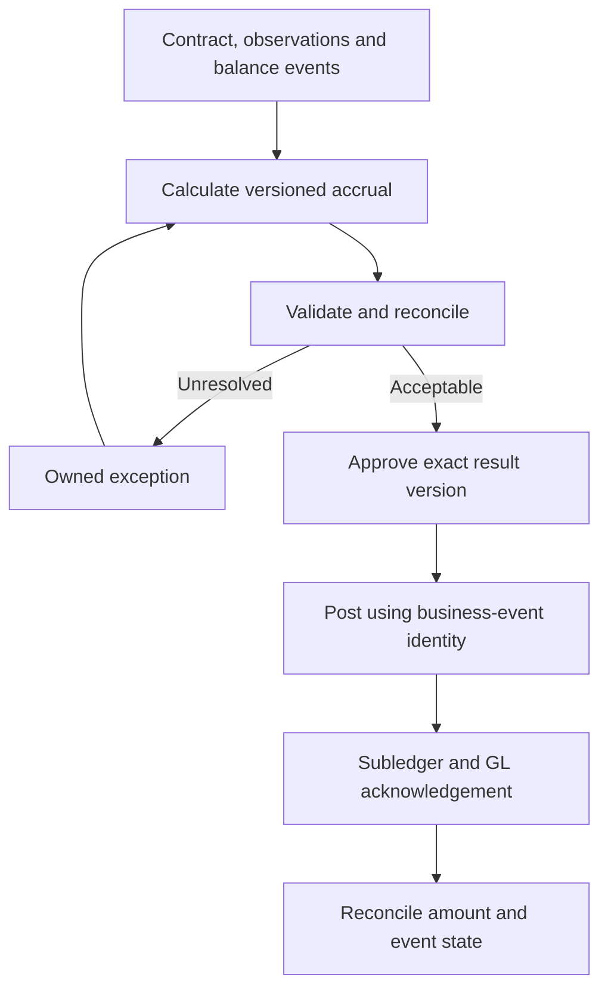

# Part 4: RegTech and Treasury Operations—Approvals, STP and Reconciliation

**Series:** Operationalising KESONIA: benchmark calculations, credit economics, treasury and governed operations
**Author:** Nevil Maloba
**Revision:** 28 September 2026

> LinkedIn reading edition, synchronised with the 28 September technical revision. Formulas are retained for the downloadable HTML; launch-post copy is separate.

## Abstract

Straight-through processing is useful when it preserves a business event's identity across calculation, approval, execution and financial records. This article develops separate accrual, reporting and treasury workflows with explicit exceptions, idempotency and reconciliation. It maps Oracle, SAP, Microsoft, MORS, Abrigo and execution services to documented responsibilities, then sets acceptance gates for a local research demonstration and a later institutional implementation. Security and audit controls protect evidence and authority; they do not create financial correctness or prove compliance by themselves.

## 1. Three workflows sharing evidence

The term **RegTech sweep** names the proposed controlled reporting workflow in this series. It is not a CBK-certified product or a prescribed implementation architecture. Its purpose is to gather validated results, reconcile them, obtain approval of an identified version and preserve the submission response.

Three connected workflows need distinct states:

| Workflow | Start | End | Important distinction |
|---|---|---|---|
| Lending accrual | Contract period and available fixing set | Approved posting and reconciled customer/subledger record | A calculated amount is not a settled receipt |
| Regulatory reporting | Approved accounting/risk sources | Submitted version, acknowledgement and reconciliation | A file created or sent is not necessarily accepted |
| Treasury STP | Scenario and proposed response | Confirmed, booked, settled and reconciled position | A hedge recommendation is not an executed trade |

STP reduces rekeying and manual handoffs while retaining required review. Exceptions remain visible; automation must not turn a timeout into an assumption of failure or an unapproved result into an executed action.

## 2. A reusable event contract

The same identity should survive each handoff. A minimum proposed message carries:

| Field group | Fields and meaning |
|---|---|
| Identity | Entity, contract/portfolio, business-event ID, event type, parent/replacement event |
| Time | Economic effective date, received time, information cutoff, execution/settlement time |
| Terms | Currency, signed amount/notional, index, direction, price, reset/payment dates |
| Evidence | Contract/fixing/curve/model versions, calculation version and input/result hash |
| Authority | Proposer, checker, permitted action, approval ID/time and approved terms |
| Processing | Message ID, idempotency key, correlation ID, status and exception code |
| Financial links | Cash-flow IDs, subledger/journal IDs, trade/confirmation IDs and report batch |

This is an internal integration proposal. A vendor or regulator may expose different fields; map and test that interface rather than assuming it implements this schema.

Separate **message identity** from **business-event identity**. Retries can have new transport IDs while representing the same posting. Conversely, a corrected amount is a new version of the business event and must not be discarded simply because the contract and date match an older record.

## 3. Accrual-to-ledger processing

The accrual workflow accepts a complete calculation record from Part 2. It checks the result against contract terms and independent fixtures, records exceptions and submits the identified version for approval. Posting uses an idempotency key including entity, contract, period, event type and calculation version.



Consider a calculation of KES 1,024.26. A repeated posting request with the same idempotency key should return the original posting result, not add another KES 1,024.26. If a corrected fixing changes the amount, create a new calculation version and an approved linked adjustment. Preserve the original request, response and posting. A successful HTTP response alone does not show that the correct entity, account, currency and period were booked.

The local demonstration should expose a replay report: original calculation, approval, first posting, duplicate request, original acknowledgement, correction and final balance. An in-memory or local-file state machine demonstrates logic. Durable persistence, concurrent processing, disaster recovery and production ledger integration require further tests.

## 4. Validation with clear ownership

Validation distinguishes hard structural failures, review signals and measurement differences:

| Control | Required response |
|---|---|
| Missing/duplicate applicable fixing, interval gap, overlapping balance events | Block affected final calculation until resolved or an authorised fallback is recorded |
| Fixing outside its historical range | Check against the source; a genuine stress move must not be smoothed away |
| Rate stored in percentage rather than decimal units | Reject incompatible schema/version; do not guess from plausible output |
| Contract convention changed | Require effective terms and permissions, then recalculate affected periods |
| Rounded index versus direct-product difference | Apply a precision-derived tolerance and retain the difference |
| Ledger/report difference | Reconcile entity, period, valuation basis, exclusions and amounts; assign unresolved breaks |
| Duplicate confirmation or posting | Return/reconcile the existing event, with no second economic effect |

A three-standard-deviation alert can be a chosen screening rule; it is not a universal regulatory rate band. Retail/corporate tolerances also need a rounding and materiality rationale. Negative benchmark values, changes in loan status and unusual cash events require product-specific rules rather than arbitrary blanket limits.

Batch continuation is a policy decision. Unaffected contracts may proceed when isolation is proven and the reporting requirement permits partial processing. A broken shared calendar or benchmark batch can require a broader stop. Record the scope, owner and rationale.

## 5. Approval, evidence retention and security

Approval binds the checker to the **exact input/result version**, permitted action and effective terms. A subsequent change invalidates that approval or triggers the defined amendment workflow. Segregation of duties should be enforced through actual roles and service permissions, including privileged administrative paths.

The proposed reporting order is prepare → validate/reconcile → resolve or document exceptions → approve → package/sign/encrypt as required → transmit through the verified channel → receive acknowledgement → reconcile and retain evidence. A diagram that signs an unapproved payload and then changes it during review has failed to specify what was authorised.

Append-only application permissions, independently retained source payloads, protected audit copies and retention controls support reconstruction. Hash chaining can reveal some alterations if trusted checkpoints are retained outside the writer's control. A hash chain alone does not prevent an administrator replacing both the data and its hashes. WORM storage can enforce configured retention but needs governance for access, retention duration, legal holds, recovery and eventual deletion obligations.

Encryption, authenticated transport, signatures and key custody protect different properties. Select them against the actual interface and threat model. Encryption does not validate a rate, and a signature does not prove an accounting conclusion. Key rotation, certificate expiry, revocation, recovery and signing authority are operating controls. This series does not assert that CBK mandates a specific AES mode, X.509 workflow or mTLS endpoint for every report.

## 6. From ALM scenario to treasury action

A scenario may identify a loss of earnings, a value sensitivity or a future cash deficit. Responses include changing funding composition, product terms, limits or buffers, as well as permitted hedges. The proposal records expected benefit, cost and remaining risks across all relevant views.

An STP transaction lifecycle can be specified as:

```text
proposed → limit-checked → approved → order-sent → acknowledged
→ executed/partially-executed → confirmed → booked → settled → reconciled
```

Rejection, cancellation, expiry, amended terms, settlement failure and unknown external status are explicit alternatives. A confirmation must match authorised direction, index, currency, notional, tenor and price tolerances. A partial fill leaves a residual exposure and an unfilled order quantity; it is not silently treated as full execution. A material price/term change returns for the required approval.

If an acknowledgement is missing, query or reconcile external status before resending an order that might already have executed. A duplicate confirmation must not create a second position. Settlement finality, collateral processing and accounting happen at distinct stages. Rerun the relevant exposures only after the resulting positions and cash are reconciled.

The [operations laboratory](../../research_lab/operations.py) demonstrates the scoped local workflow and failure fixtures reported in [worked examples](../../docs/methods/WORKED_EXAMPLES.md). A simulated confirmation establishes no venue connection, execution right, clearing membership or local instrument availability.

## 7. Platform roles: useful capabilities and acceptance questions

The September 25 software review checked primary vendor material. It is a dated capability record, not an implementation certification or vendor ranking. Procurement must confirm the selected release, licence, instrument/currency support and tested configuration.

### Oracle financial-services analytics

Oracle's ALM and FTP documentation describes cash-flow, repricing, rate-conversion, option-cost and simulation capabilities. The useful integration is a common contract/cash-flow input feeding purpose-specific analyses, with detailed results available for reconciliation. FTP allocates funding economics; ALM analyses behaviour and rate scenarios; accounting owns recognition.

The interface specification should identify contract identifiers, balance events, rate codes, behavioural assumptions, curve versions, cash-flow output fields and business-unit attribution. Acceptance requires independent fixture agreement, an explanation of differences between pricing and accounting assumptions, and stable reruns. The existence of an ALM module does not prove that a KESONIA contract convention or current Kenyan return is configured. [Oracle cash-flow reference, 8.1.2 documentation](https://docs.oracle.com/en/industries/financial-services/ofs-analytical-applications/analytical-applications-infrastructure/812/cferg/overview6.html).

### SAP Treasury and Risk Management, FPSL and the ledger

SAP Treasury and Risk Management supports transaction/valuation functions and accounting integration. FPSL provides financial-products subledger functions. The general ledger holds approved accounting records. These responsibilities should not be collapsed into the statement that FPSL automatically performs bank ALM, credit repricing and every modification test.

A reference adapter carries origination, scheduled reset, repayment, approved modification, impairment assessment and settlement as different events. Finance supplies the applicable recognition/measurement rules, account mappings and multi-GAAP requirements. Reconciliation remains necessary between the external contract/cash engine, subledger and ledger even when a universal-journal design reduces internal duplication. [SAP TRM documentation](https://help.sap.com/docs/SAP_S4HANA_CLOUD/4574d8b965404a45a11e19a8d0fbe96f/cf31a5fa099043919c7076059964b24a.html); [SAP FPSL documentation](https://help.sap.com/doc/4234275c8b3b44a8b5503eec0c1c0ad8/2306.005/en-US/Finanzprodukt_Nebenbuch_EN.pdf).

### Dynamics 365 Finance and an Azure calculation service

Dynamics 365 Finance can supply financial records and consume external forecasts/integration data. An Azure-based design can separate source storage, orchestration, calculation, model serving, evidence retention and reporting. This is a proposed distribution of responsibilities, not proof of native banking FTP, IRRBB or swap execution in Finance.

Specify whether an integration uses approved data entities, OData or batch transfer, and how responses map to business events. An external accrual adapter should send an approved journal/event payload, preserve the ledger identifier and reconcile the posted amount. Power BI presents results; a dashboard refresh does not certify underlying completeness. A natural-language assistant may retrieve approved evidence, but any proposed financial action still requires the normal authority path. [Microsoft integration overview](https://learn.microsoft.com/en-us/dynamics365/fin-ops-core/dev-itpro/data-entities/integration-overview); [cash forecasting](https://learn.microsoft.com/en-us/dynamics365/finance/cash-bank-management/cash-flow-forecasting).

### MORS, Abrigo and execution services

MORS documents ALM, FTP and treasury-management capabilities. Its January 2025 Bloomberg integration describes pre-deal limit checking, a soft-deal identifier, dealer entry and returned confirmation matching. That is a useful concrete pattern for identity across approval and execution; it does not show autonomous hedge selection or KESONIA swap support. [MORS–Bloomberg workflow](https://morssoftware.com/mors-enhances-tms-with-bloomberg-trade-workflow-automation/).

Abrigo documents ALM cash-flow assumptions, scenario analysis, liquidity and EVE reporting. Those capabilities fit analysis and ALCO decision support; the reviewed material does not establish a universal direct hedge-execution route. [Abrigo ALM](https://www.abrigo.com/software/portfolio-risk-cecl/asset-liability/).

Bloomberg SEF and Tradeweb document execution facilities for specified products; LSEG Workspace/FXall identifies an FX workflow. Check participant eligibility, currency, instruments, tenors, collateral, clearing and connectivity for the actual institution. FX capability alone is not an interest-rate-swap execution route. The [detailed software review](../../docs/research/kesonia/STP_AND_ALM_FTP_SOFTWARE_REVIEW_2026-09-25.md) retains the primary source map and product-specific limitations.

## 8. Regulatory risk modules have separate perimeters

Shared positions and curves can feed multiple measures, but one measure cannot replace another:

| Module | Required scope and evidence |
|---|---|
| Banking-book IRRBB | Banking-book cash, behaviour, earnings/value assumptions and applicable supervisory basis |
| FRTB | Regulatory book/desk assignment, instrument risk factors, sensitivities and method/version |
| SA-CCR | Derivative netting set, collateral and rule-based counterparty exposure calculation |
| CVA valuation | Expected exposure and counterparty credit under a declared valuation model |
| CVA capital | Separately applicable prudential method, risk factors and permitted hedges |
| Liquidity/LCR/NSFR | Dated usable cash plus separately classified regulatory assets, liabilities and commitments |
| Hedge accounting | Qualifying designation, measurement, ineffectiveness, journals and discontinuation |

For FRTB's standardised approach, the conceptual component map is $K_{SA}=K_{SbM}+K_{DRC}+K_{RRAO}$. This is distinct from internal-model expected shortfall, risk-factor modellability and desk validation. The dedicated [FRTB note](../../docs/research/kesonia/FRTB_SCOPE_AND_DEVELOPMENT_NOTE_2026-09-25.md) specifies the development requirements. A borrower loan or SPV note does not acquire a trading-book treatment merely because Treasury monitors it.

For every module record legal entity, jurisdiction, rule/effective date, product/book, method, source and intended use. Basel material supplies a global framework; adoption and permitted treatment for the intended Kenyan institution need their own evidence. The deterministic research core does not claim to complete these advanced capital or hedge-accounting engines.

Kenya has a confirmed local basis for the liquidity and leverage modules: CBK's April 2025 guidelines apply to institutions licensed under the Banking Act and took effect on 1 October 2025. They address LCR, NSFR and the leverage ratio. The implementation must therefore map eligible institutions and their positions to those local provisions, rather than leave Kenyan adoption unresolved. This confirmation does not establish the same scope for a DCP, insurer or SPV. [CBK guidelines](https://www.centralbank.go.ke/wp-content/uploads/2025/04/GUIDELINES-ON-BASEL-III-LIQUIDITY-STANDARDS-AND-LEVERAGE-RATIO.pdf).

## 9. Delivery through acceptance gates

| Gate | Deliverable | Evidence to retain |
|---|---|---|
| 1. Scope and definitions | Contract convention sheet, quantity dictionary, entity/rule map | Named owners, dated sources, unresolved interpretation register |
| 2. Benchmark and cash | Interval ledger, direct/index comparison, dated balance events | Independent amounts, boundary fixtures, correction/replay results |
| 3. Curves and funding | Instrument bootstrap, projection/discount separation, dated FTP | Quote repricing, sensitivity, unsupported-tenor flags, allocation reconciliation |
| 4. Behaviour and scenarios | Explicit deposit/prepayment/draw assumptions and common event path | Cash/balance reconciliation; later empirical calibration and uncertainty |
| 5. Workflow | Local posting/reporting/trade state machines | Duplicate, delayed, changed and failed-event tests; precise simulated scope |
| 6. Institutional interfaces | Selected module/version, authorised channel and access model | Sandbox results, financial reconciliation, performance and recovery evidence |

Tests start at the first gate. Advanced ML is introduced only after the baseline financial and operating paths can be reproduced. No fixed week count can substitute for resolving dependencies, data access, source interpretations and acceptance failures.

Useful operating measures include calculation completion, value of unreconciled breaks, exception age, manual touches, duplicate economic effects prevented, time to acknowledgement and time to reconciliation. Report distributions and failed cases, not only average latency.

## 10. Reporting standards and the wider workbench

Adopt the actual reporting schema and transmission specification. ISO 20022 provides financial-message definitions and related structures; its use in payment systems does not establish that every prudential return uses that standard or that CBK expects a continuous stream of model explanations. Treat future supervisory connectivity as a separate, evidenced interface.

SokoIntel can reuse the dictionary, event schemas and scenario outputs as a financial analysis workbench. Exporting an explained result differs from placing a trade or maintaining the legal ledger. Mwendo can reuse the same controls for claims, refund receipts, reserves and waterfall distributions without importing a bank's full trading stack. Underwrite for Collection contributes the lawful action and outcome definitions. Owner Earnings adds the final question of what cash can be distributed after operating needs, debt, liquidity and capital constraints.

The series now has a coherent computational route: evidence produces contractual cash; cash and behaviour produce pricing and risk views; authorised decisions produce events; reconciliation establishes what actually happened. The remaining-work register preserves the empirical, specialist and live-integration tasks that cannot be completed by diagrams or vendor descriptions alone.

## References and supporting evidence

- [CBK August 2025 framework](https://www.centralbank.go.ke/wp-content/uploads/2025/08/Revised-Risk-based-Credit-Pricing-Model.pdf): Kenyan pricing/reporting scope, distinct from proposed implementation choices.
- [BCBS operational-resilience principles](https://www.bis.org/bcbs/publ/d516.htm): comparative operational framework, with local applicability separately established.
- [STP and ALM/FTP review](../../docs/research/kesonia/STP_AND_ALM_FTP_SOFTWARE_REVIEW_2026-09-25.md): dated primary vendor capability review.
- [FRTB scope note](../../docs/research/kesonia/FRTB_SCOPE_AND_DEVELOPMENT_NOTE_2026-09-25.md) and [18-item remaining-work register](../../docs/methods/REVIEW_INTEGRATION_AND_REMAINING_WORK.md).
- [Worked examples](../../docs/methods/WORKED_EXAMPLES.md) and [source/scope register](../../docs/methods/SCOPE_AND_SOURCE_REGISTER.md): executable demonstration boundaries and validation evidence.
